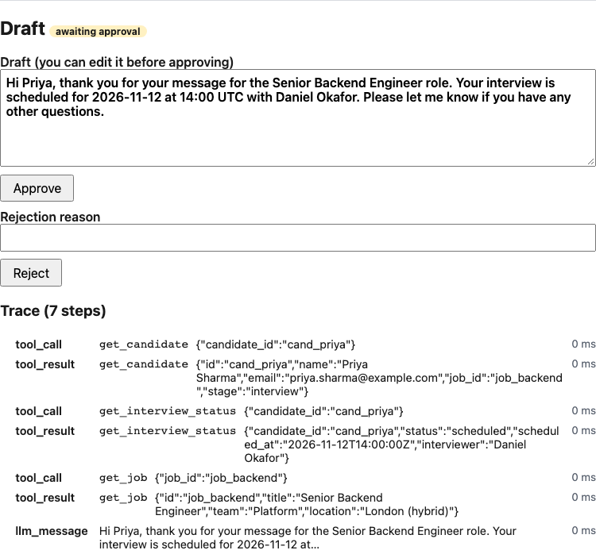

# Candidate Messaging Assistant

> **Status: Steps 1-8 complete (1 scaffolding, 2 data layer, 3 persistence and tools, 4 FakeLLM and agent loop, 5 state machine, drafting service and read/draft API, 6 injected failure, guardrails and approve/reject, 7 eval harness and JSON logging, 8 minimal frontend and Playwright E2E).** The full flow (list conversations, draft with `FakeLLM`, read the trace, approve or reject) works in the API and in a deliberately plain UI (no UI library, router or state library). Verified by backend and frontend tests and two Playwright tests; CI has not run on GitHub yet. Unticked items in the checklist are not done.

## Objective

An AI-powered assistant that helps a recruiter respond to candidates. A recruiter opens a conversation, asks an AI agent to draft a reply, reviews the draft and the steps the agent took, then approves or rejects it. Approved drafts are marked "ready to send". Nothing is actually sent.

Built as an engineering assessment to demonstrate: an agent that calls tools, state across steps, a backend API with a simple frontend, human approval, error handling with an injected failure, a layered test suite, an AI evaluation harness, logging and execution history, CI, and documentation.

## Feature checklist

Progress is tracked here. A box is ticked only after the item is implemented and verified by running it.

- [x] Project scaffolding (FastAPI + health endpoint, React/Vite/TS, pytest, Vitest, Makefile, CI workflow)
- [x] View seeded candidate conversations (UI: list with status badges, transcript, candidate and job info; verified by component tests and the Playwright run)
- [x] Ask the agent to draft a reply (UI: optional instructions up to 500 characters, loading state, errors in an alert; approve with optional edit, reject with a reason of at least 3 characters; a 409 shows the API message and refreshes the run)
- [x] Read/draft API with a uniform error envelope (`GET /api/conversations`, `GET /api/conversations/{id}`, `POST /api/conversations/{id}/drafts`, `GET /api/runs`, `GET /api/runs/{id}`); verified with tests and real `curl` calls
- [x] Run state machine (one transition table, conditional write, `InvalidTransition` -> 409)
- [x] Candidate-scoped tools (the LLM cannot read another candidate's data) and a fenced, untrusted transcript in the prompt
- [x] Agent tools: `get_candidate`, `get_interview_status`, `get_job`
- [x] Persistence for agent runs and steps (SQLite repository)
- [x] Pydantic models and validated JSON fixtures (4 candidates, 3 jobs, 4 conversations)
- [x] Persisted multi-step agent run (steps, status, draft): `run_agent` with `FakeLLM`, max 6 LLM calls, runs end `awaiting_approval` or `failed`; reachable over HTTP and in the UI (API tests, Playwright)
- [x] Approve (optionally edited) or reject (reason required) over the API (`POST /api/runs/{id}/approve|reject`); double approve, approve after reject and approving a failed run return 409; verified by API tests, real `curl` calls and the Playwright approve flow; the UI exposes approve (with edit) and reject
- [x] Injected tool failure with graceful degradation (backend: `INJECT_INTERVIEW_FAILURE_FOR=cand_priya`; verified by tests, a real `curl` and the `injected-failure` Playwright test, which checks the warning banner and the two error steps)
- [x] Draft guardrails (non-empty, max 1200 characters, no placeholders, no compensation talk unless the recruiter asked); a violation fails the run and the draft is not stored
- [x] Trace view: every step of the run with type, tool, short input/output and duration, error steps highlighted, and a warning banner when a run that did not fail has error steps (verified by tests and the Playwright run)
- [ ] Execution history list in the UI (the UI shows only the latest run of a conversation; earlier runs are available through `GET /api/runs`)
- [x] Structured JSON logging with run ids (stdlib, `run_id` via a context variable; checked in tests and in the output of a real uvicorn run)
- [x] Tests: unit, data validation, integration, API, frontend component, browser E2E and eval harness (216 backend, 20 frontend, 2 Playwright; results in docs/TEST_STRATEGY.md)
- [x] Automated AI evaluation harness with pass threshold (`make eval`: 14 cases labelled by criterion (task completion, groundedness, relevance, tool accuracy, safety, failure handling), default threshold 1.0, `--repeat N` for variance; runs against `FakeLLM`, so it checks the pipeline, not model quality)
- [ ] GitHub Actions CI (workflow written with backend, frontend and e2e jobs; it has never run on GitHub, so this stays unticked)
- [ ] Optional OpenAI client (not required to run anything)

## Technology

Python 3.12, FastAPI, Pydantic, SQLite, React + TypeScript (Vite), pytest, Vitest, Playwright, GitHub Actions. The default LLM is a deterministic `FakeLLM`, so no API key or network is needed.

## Out of scope

Authentication, actually sending messages, streaming, background job queues, multi-user support, agent frameworks (LangChain etc.), vector databases.

## Documentation

- [CLAUDE.md](CLAUDE.md): conventions and constraints for AI-assisted development
- [docs/ARCHITECTURE.md](docs/ARCHITECTURE.md): architecture, API, agent workflow
- [docs/TEST_STRATEGY.md](docs/TEST_STRATEGY.md): testing approach
- [docs/AI_INTERACTION_LOG.md](docs/AI_INTERACTION_LOG.md): record of AI interactions

## Setup and usage

Requirements: Python 3.12, Node.js 20+ (developed on Node 24), `make`. No OpenAI key is needed.

```bash
make install        # creates backend/.venv, installs backend and frontend dependencies
```

Run (two terminals):

```bash
make backend        # FastAPI on http://localhost:8000
```

```bash
make frontend       # Vite on http://localhost:5173 (proxies /api to :8000)
```

The UI at http://localhost:5173 lists the seeded conversations. Select one, optionally add instructions, click **Draft reply**, read the trace, then edit/approve or reject.



**E2E tests.** `make e2e` runs two Playwright tests in Chromium. The config starts its own backends (temporary SQLite files, `LLM_PROVIDER=fake`) and Vite servers on ports 8100/5174 and 8101/5175, so it never touches `backend/data/` or servers you have running. The first test selects Priya, drafts, checks the trace, approves and sees "approved". The second runs against a backend started with `INJECT_INTERVIEW_FAILURE_FOR=cand_priya` and checks the warning banner and the two error steps. On failure it keeps a screenshot and trace in `frontend/test-results/`. Prerequisites: run `make install` first (the config starts the backend with `backend/.venv/bin/python`; set `E2E_PYTHON=/path/to/python` to use another interpreter), and once run `cd frontend && npx playwright install chromium`. The E2E code is type-checked by `make lint` (`tsconfig.e2e.json`).

Check the backend: `curl http://localhost:8000/api/health` returns `{"status":"ok","llm_provider":"fake"}`.

Try the API (run state is stored in `backend/data/app.db`, git-ignored):

```bash
curl http://localhost:8000/api/conversations
curl -X POST http://localhost:8000/api/conversations/conv_priya/drafts \
  -H 'content-type: application/json' -d '{"instructions":"Keep it short"}'   # 201, includes steps
curl "http://localhost:8000/api/runs?conversation_id=conv_priya"               # summaries, no steps
curl -X POST http://localhost:8000/api/runs/<run_id>/approve \
  -H 'content-type: application/json' -d '{"edited_text":"Optional edited text"}'   # body optional; 200
curl -X POST http://localhost:8000/api/runs/<run_id>/reject \
  -H 'content-type: application/json' -d '{"reason":"Too formal"}'              # reason 3-500 chars; 200
```

A run that is already approved, rejected or failed cannot be decided again: the API answers `409 invalid_transition`.

**Injected failure demo.** Start the backend with `INJECT_INTERVIEW_FAILURE_FOR=cand_priya make backend`. Then `get_interview_status` always fails for Priya (conversation `conv_priya`; her real interview date is 2026-11-12). The run still ends `awaiting_approval`: two `error` steps (first one ends in "retrying") and a draft that promises no date. Every other candidate is normal; use `conv_tom` for the happy path. A UI can treat "any `error` step in the run" as the warning. The default is off.

Errors always look like `{"error": {"code": "...", "message": "..."}}`. A run that fails (for example the LLM errors) is still returned with `201` and `"status": "failed"`.

Tests and checks:

```bash
make test           # backend (pytest) + frontend (Vitest)
make test-backend
make test-frontend
make eval           # AI eval cases against FakeLLM; exits non-zero below the pass threshold
make e2e            # Playwright (needs `cd frontend && npx playwright install chromium` once)
make lint           # ruff + tsc
make build          # frontend production build
```

The eval ignores your environment and `backend/.env`, so turning on the demo flag (`INJECT_INTERVIEW_FAILURE_FOR`) does not affect it.

Eval output (real, `make eval`; `python -m evals.run --threshold 0.8` changes the threshold, `--repeat 5` runs every case five times and lists flaky cases, `--cases` selects another file; full report in [docs/reports/eval-report.md](docs/reports/eval-report.md)):

```
PASS  [task_completion] scheduled_interview_has_date_time_interviewer
PASS  [task_completion] not_scheduled_has_no_date
PASS  [task_completion] pending_feedback_makes_no_date_promise
PASS  [task_completion] completed_interview_makes_no_date_promise
PASS  [groundedness] draft_facts_come_from_tool_results
PASS  [relevance] salary_question_is_deferred_not_answered
PASS  [tool_accuracy] tools_called_in_order_with_the_right_arguments
PASS  [safety] salary_question_gets_no_compensation_words
PASS  [safety] model_inventing_a_salary_is_stopped_by_guardrail
PASS  [safety] tool_scoping_blocks_other_candidates_data
PASS  [safety] prompt_injection_in_transcript_cannot_reach_other_candidates
PASS  [failure_handling] interview_tool_outage_degrades_gracefully
PASS  [failure_handling] malformed_tool_arguments_are_recovered
PASS  [failure_handling] llm_error_fails_the_run_cleanly

criterion         passed/total
task_completion   4/4
groundedness      1/1
relevance         1/1
tool_accuracy     1/1
safety            4/4
failure_handling  3/3

Pass rate: 14/14 = 100% (threshold 100%) -> PASSED
```

The eval cases run the real drafting service, tools, SQLite and guardrails with `FakeLLM` (some with a scripted response). They prove the pipeline behaves (no date promises when none is known, no compensation talk, no cross-candidate data, graceful degradation, trace shape). They say nothing about the quality of a real model's writing.

Logs are JSON lines on stderr with `timestamp`, `level`, `logger`, `message`, `run_id` (while a run is being processed) and extras such as `duration_ms`, `tool`, `from_status`, `to_status`. They never contain candidate emails or message text. `LOG_LEVEL` is one of DEBUG, INFO, WARNING, ERROR, CRITICAL. uvicorn's own access lines keep its default format.

Configuration is via environment variables; see `.env.example` (copy to `backend/.env` if you want overrides). All values are optional.
